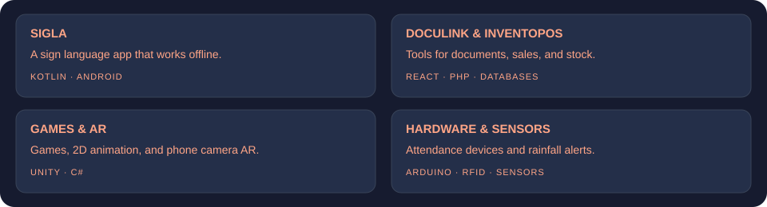

  
    
  

  
  
  

<a href="#about-me">About me</a> &nbsp; · &nbsp; <a href="#tech-stack">Tech stack</a> &nbsp; · &nbsp; <a href="#selected-projects">Projects</a> &nbsp; · &nbsp; <a href="#github-analytics">Analytics</a>

 

I'm **Juan Domanico Militante (Ikoy)**, a Web and Mobile Developer and Information Technology student at **Pambayang Dalubhasaan ng Marilao**.

I have **4 years of experience** building websites and mobile apps. I like creating tools that are simple, useful, and easy to use — from apps that work offline to web systems for documents, sales, and stock.

 

 

 

 

Updated daily from public GitHub data. Commit charts cover my authored commits on default branches of owned public repositories. Language donuts use each repository's main language.

<a href="mailto:militantejuanenricodomanico@gmail.com">Have a project in mind? Let's talk.</a>

