  
  
  
  
  
<a href="#about-me">About Me</a> &nbsp; · &nbsp; <a href="#tech-stack">Tech Stack</a> &nbsp; · &nbsp; <a href="#selected-projects">Projects</a> &nbsp; · &nbsp; <a href="#github-analytics">Analytics</a> &nbsp; · &nbsp; <a href="#achievements">Achievements</a>

<a href="mailto:militantejuanenricodomanico@gmail.com">Email</a> · <a href="https://portfolio.juandomanicomilitante.workers.dev">Portfolio</a> · <a href="https://www.linkedin.com/in/juan-domanico-militante-b0972b363/">LinkedIn</a>

Updated daily from public GitHub data. Commit and language charts cover owned public repositories; languages use each repository's main language. Streaks count consecutive contribution days, not total active days. One Piece inspired fan artwork.

